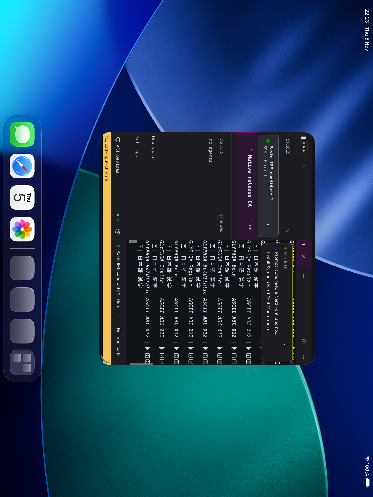
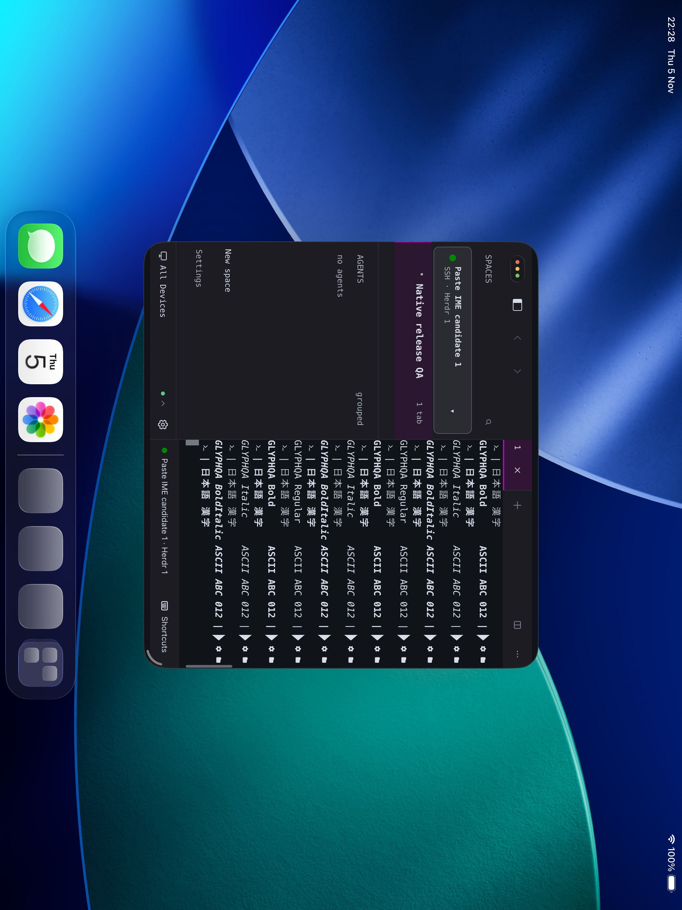
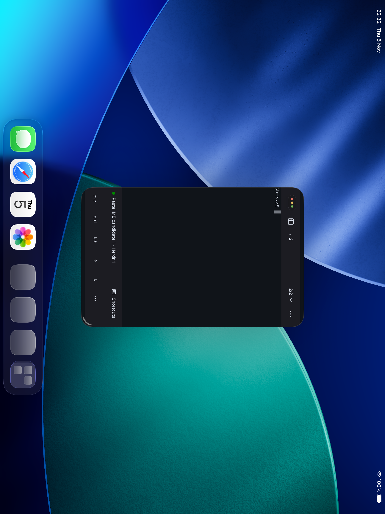
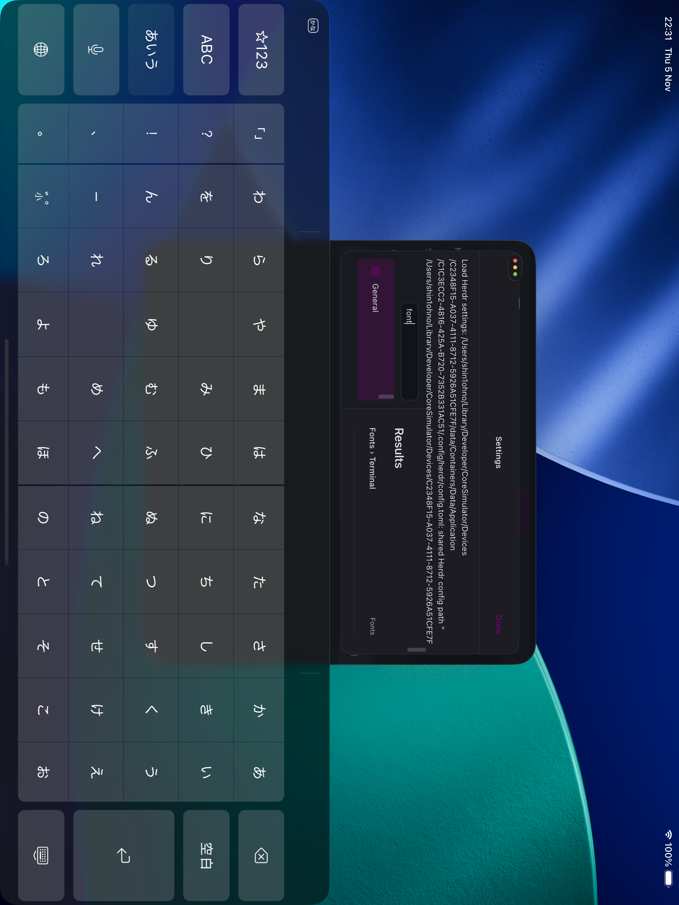

# iPad release chrome and fonts native QA

These are unmodified XCTest screenshots from an iPad Pro 13-inch (M5)
simulator running iOS 26.5 (23F77), in actual windowed mode.
The terminal contains a public glyph fixture on a private test backend.

| Before | Candidate |
| --- | --- |
|  |  |

The before executable SHA-256 is
`917fbe7b4524b1d53e8df72ec59667982d293ca80dc8b50169afc3d583c4fa56`.
The candidate executable SHA-256 is
`d1283a54f93ea0dbeda3cec6d0cb8c854ef834ae51ec592d70079bf7acd210c0`.
Both captures use the same simulator and backend; their window origins differ.

The independent reviewer observed no release worktree band, all four font
styles, Japanese, sidebar opening and closing at both widths, actual backend
Back/Forward destinations, and Settings search input and filtering.
F013/F07B/F120 resolve to SauceCodeProNFM; E0B0 uses GPUI triangle painting.
ASCII resolves to Menlo and Japanese to Hiragino Sans.

Full 44pt hitbox nonintersection with native OS controls remains unmeasured
in native accessibility: the GPUI hitbox bounds are not exposed there.
The visible controls and exercised taps clear the OS pill at both widths;
compact mode intentionally has no Back/Forward arrows. Deterministic GPUI
geometry tests separately check the bounds with injected platform insets.
These screenshots do not prove physical keyboard, IME, Escape, or physical
iPad behavior. The physical device was not modified. Light-theme native QA
was not repeated for this candidate.
